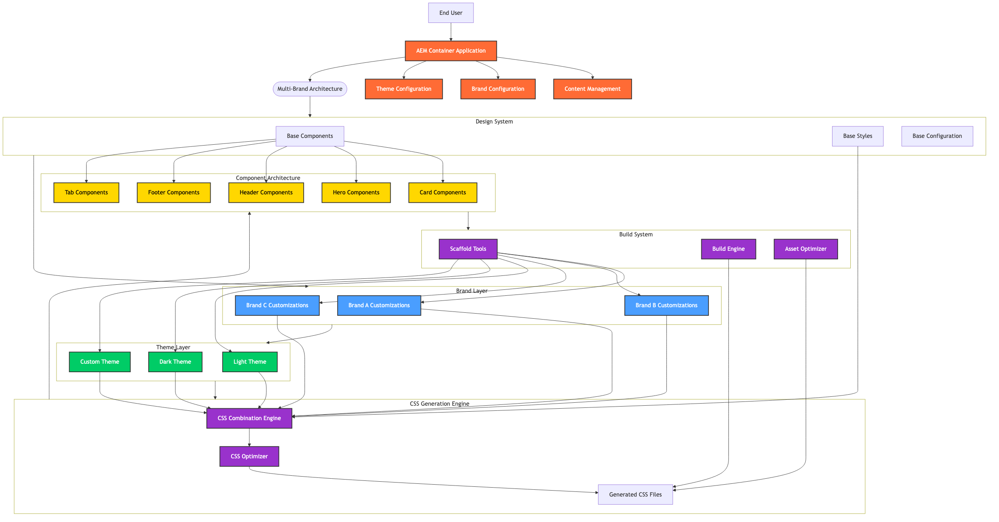
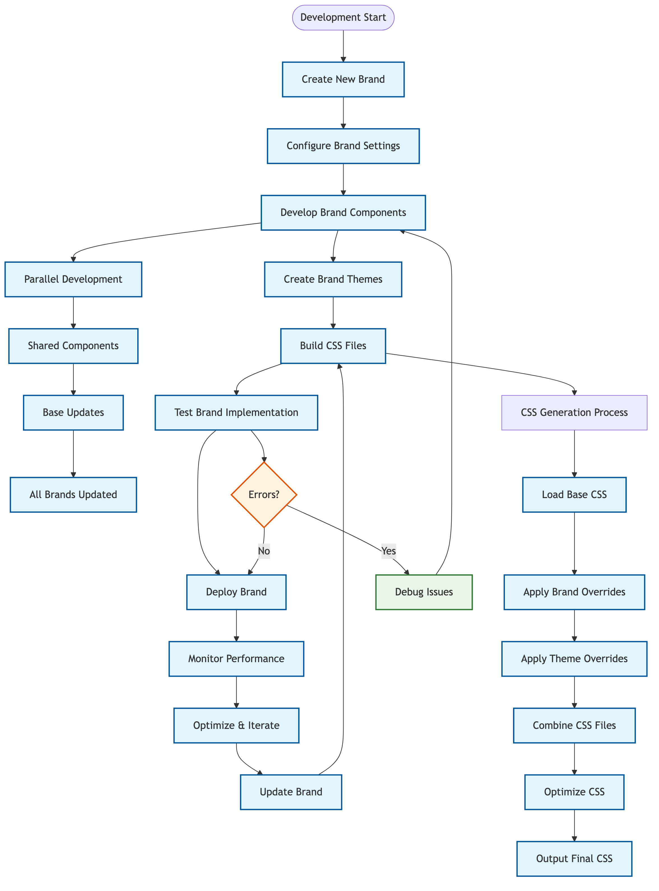
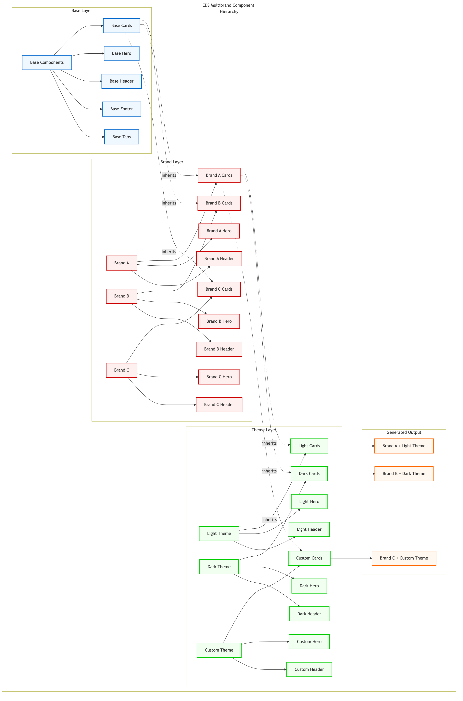

# EDS Multibrand: A Comprehensive Multi-Brand Architecture for Adobe Experience Manager

## Table of Contents

- [EDS Multibrand: A Comprehensive Multi-Brand Architecture for Adobe Experience Manager](#eds-multibrand-a-comprehensive-multi-brand-architecture-for-adobe-experience-manager)
  - [Table of Contents](#table-of-contents)
  - [1. Introduction](#1-introduction)
    - [1.1. Overview of the whitepaper](#11-overview-of-the-whitepaper)
    - [1.2. Purpose and objectives of the Multi-Brand Architecture](#12-purpose-and-objectives-of-the-multi-brand-architecture)
    - [1.3. Key Challenges Addressed](#13-key-challenges-addressed)
  - [2. Understanding Multi-Brand Architecture](#2-understanding-multi-brand-architecture)
    - [2.1. Definition of Multi-Brand Architecture](#21-definition-of-multi-brand-architecture)
    - [2.2. Advantages of Multi-Brand Architecture](#22-advantages-of-multi-brand-architecture)
    - [2.3. Key principles and components of Multi-Brand Architecture](#23-key-principles-and-components-of-multi-brand-architecture)
    - [2.4. How Multi-Brand Architecture overcomes challenges faced by traditional approaches](#24-how-multi-brand-architecture-overcomes-challenges-faced-by-traditional-approaches)
  - [3. Business Case](#3-business-case)
    - [3.1. Problem Statement](#31-problem-statement)
    - [3.2. Proposed Solution](#32-proposed-solution)
    - [3.3. Benefits of the Proposed Solution](#33-benefits-of-the-proposed-solution)
  - [4. Solution and Architecture](#4-solution-and-architecture)
    - [4.1. Solution Architecture Diagram](#41-solution-architecture-diagram)
    - [4.2. Architecture Flow Diagram](#42-architecture-flow-diagram)
    - [4.3. Component Hierarchy Diagram](#43-component-hierarchy-diagram)
    - [4.4. Design System (Reusable Component Library)](#44-design-system-reusable-component-library)
    - [4.5. Multi-Brand Theme Management](#45-multi-brand-theme-management)
    - [4.6. CSS Generation and Optimization](#46-css-generation-and-optimization)
    - [4.7. Configuration Management](#47-configuration-management)
    - [4.8. Architectural Benefits](#48-architectural-benefits)
  - [5. Implementation](#5-implementation)
    - [5.1. Code Repository Setup](#51-code-repository-setup)
    - [5.2. Directory Structure](#52-directory-structure)
    - [5.3. Development Workflow](#53-development-workflow)
    - [5.4. Core Features](#54-core-features)
      - [5.4.1. Multi-Brand Support](#541-multi-brand-support)
      - [5.4.2. Multi-Theme Support](#542-multi-theme-support)
      - [5.4.3. Component Architecture](#543-component-architecture)
      - [5.4.4. Automated Build System](#544-automated-build-system)
    - [5.5. CSS Combination Hierarchy](#55-css-combination-hierarchy)
    - [5.6. Generated CSS Files](#56-generated-css-files)
    - [5.7. JavaScript Architecture](#57-javascript-architecture)
    - [5.8. Configuration Management](#58-configuration-management)
    - [5.9. Development Tools and Automation](#59-development-tools-and-automation)
      - [5.9.1. Scaffold Commands](#591-scaffold-commands)
      - [5.9.2. Verbose Logging](#592-verbose-logging)
    - [5.10. Performance and Optimization](#510-performance-and-optimization)
      - [5.10.1. CSS Optimization](#5101-css-optimization)
      - [5.10.2. JavaScript Optimization](#5102-javascript-optimization)
      - [5.10.3. Build Performance](#5103-build-performance)
    - [5.11. Best Practices](#511-best-practices)
      - [5.11.1. Brand Development](#5111-brand-development)
      - [5.11.2. Theme Development](#5112-theme-development)
      - [5.11.3. Component Development](#5113-component-development)
      - [5.11.4. Build and Deployment](#5114-build-and-deployment)
    - [5.12. Use Cases and Benefits](#512-use-cases-and-benefits)
      - [5.12.1. Enterprise Organizations](#5121-enterprise-organizations)
      - [5.12.2. Digital Agencies](#5122-digital-agencies)
    - [5.13. Scope for Optimization](#513-scope-for-optimization)
  - [6. Future Considerations](#6-future-considerations)
    - [6.1. Multi-Brand Architecture in Headless AEM](#61-multi-brand-architecture-in-headless-aem)
    - [6.2. Advanced Theme Management](#62-advanced-theme-management)
    - [6.3. Performance Optimization Strategies](#63-performance-optimization-strategies)
  - [7. Conclusions](#7-conclusions)
  - [8. Resources](#8-resources)
    - [8.1. Documentation and Guides](#81-documentation-and-guides)
    - [8.2. Multi-Brand Architecture Resources](#82-multi-brand-architecture-resources)
    - [8.3. Development Tools](#83-development-tools)
    - [8.4. Best Practices and Standards](#84-best-practices-and-standards)

---

## 1. Introduction

### 1.1. Overview of the whitepaper

This whitepaper outlines the implementation of a Multi-Brand Architecture by leveraging Adobe Experience Manager (AEM) as a comprehensive platform for managing multiple brand experiences within a single project. By adopting this modern architectural approach, organizations can maintain distinct brand identities while sharing underlying functionality and components, resulting in improved development efficiency, brand design consistency, and operational scalability.

EDS Multibrand is an innovative starter project that extends the Adobe AEM Boilerplate to provide comprehensive multi-brand support within a single AEM project.

### 1.2. Purpose and objectives of the Multi-Brand Architecture

The primary purpose of implementing a Multi-Brand Architecture is to create a unified, flexible, and scalable system that enables organizations to manage multiple brand experiences efficiently while maintaining code reusability and design consistency. The objectives include:

- **Centralized Management**: Streamline the management of multiple brands within a single codebase

- **Brand Consistency**: Ensure consistent design systems and user experiences across all brands

- **Development Efficiency**: Reduce development time through shared components and automated processes

- **Operational Scalability**: Support unlimited brands and themes without performance degradation

- **Cost Optimization**: Minimize development and maintenance costs through code reuse

### 1.3. Key Challenges Addressed

- **Brand Consistency**: Maintaining consistent design systems across multiple brands

- **Code Efficiency**: Avoiding code duplication while supporting brand-specific customizations

- **Scalability**: Supporting unlimited brands and themes without performance degradation

- **Maintainability**: Centralized management of shared components and styles

- **Development Velocity**: Rapid brand creation and deployment capabilities

## 2. Understanding Multi-Brand Architecture

### 2.1. Definition of Multi-Brand Architecture

Multi-Brand Architecture is an architectural approach that enables organizations to manage multiple brand experiences within a single application framework. It involves creating a layered system where base components and styles are shared across all brands, while brand-specific customizations and themes are applied through a sophisticated override system. This architecture allows for independent brand development while maintaining a unified codebase.

### 2.2. Advantages of Multi-Brand Architecture

- **Flexibility**: Multi-Brand Architecture empowers teams to work independently on different brands while maintaining consistency through shared components and design systems.

- **Brand Consistency**: Centralized design system ensures consistent user experiences across all brands, maintaining brand integrity and customer trust.
  
- **Scalability**: Support for unlimited brands and themes without performance degradation, enabling organizations to expand their brand portfolio efficiently.

- **Faster Development**: Shared components and automated build processes enable parallel development, reducing time-to-market for new brands and features.

- **Enhanced User Experience**: Multi-Brand Architecture enables personalized brand experiences while maintaining performance and reliability across all touchpoints.

- **Modularity**: The layered approach makes it easier to add, update, or remove brands without affecting the entire system.

- **Future-proofing**: The architecture's flexibility ensures adaptability to emerging technologies and new brand requirements.

- **Improved Performance**: Optimized CSS generation and loading strategies deliver content faster and reduce latency.

- **Easier Maintenance**: Separation of concerns allows for easier debugging, monitoring, and maintenance of individual brands.

- **Cost Efficiency**: Code reuse and shared infrastructure contribute to significant cost savings in development and maintenance.

- **Cross-Team Collaboration**: Multi-Brand Architecture encourages cross-functional teams to focus on specialized areas while maintaining consistency.

- **Service Reusability**: Shared components and utilities promote reuse across multiple brands, reducing redundant development efforts.

### 2.3. Key principles and components of Multi-Brand Architecture

- **Layered Architecture**: Base layer (shared components), brand layer (brand-specific customizations), and theme layer (visual variations)

- **Component Isolation**: Ensuring brand-specific components operate independently without interference

- **CSS Hierarchy**: Sophisticated CSS combination process that merges base, brand, and theme styles

- **Configuration Management**: Centralized configuration system for managing brands and themes

- **Automated Build System**: Automated CSS generation and optimization processes

### 2.4. How Multi-Brand Architecture overcomes challenges faced by traditional approaches

Multi-Brand Architecture addresses the limitations of traditional approaches, such as code duplication, inconsistent user experiences, and inefficient resource utilization. It enables a more agile development approach, promotes team autonomy, and fosters continuous deployment, resulting in improved brand management and customer experience.

## 3. Business Case

### 3.1. Problem Statement

**Large-scale organizations with multiple brands** face significant challenges in maintaining brand consistency, managing development resources efficiently, and adapting to market demands across their brand portfolio. Traditional approaches often result in code duplication, inconsistent user experiences, increased development costs, and longer time-to-market for new brands. This whitepaper presents a solution that enables dynamic brand management, scalable development processes, and seamless integration across multiple brand experiences.

### 3.2. Proposed Solution

To address the challenges faced by organizations managing multiple brands, the proposed solution is to implement a Multi-Brand Architecture utilizing Adobe Experience Manager (AEM) as the foundation platform. This architecture ensures that brand experiences remain completely decoupled from shared functionality, enabling independent brand development while maintaining consistency through shared components and design systems.

### 3.3. Benefits of the Proposed Solution

- **Dynamic Brand Management with AEM**: Utilizing AEM as a multi-brand platform allows organizations to manage brand-specific content, themes, and configurations in real-time without the need for redeployment. This enables personalized brand experiences and rapid brand updates.

- **Scalability and Reusability with Multi-Brand Architecture**: The adoption of Multi-Brand Architecture promotes reusability of components across multiple brands, ensuring consistent user experiences while reducing development effort and maintenance costs.

- **Faster Brand Development and Deployment**: Independent brand development enables faster development cycles, and updates to one brand do not require redeployment of the entire system, streamlining the release process.

- **Enhanced Brand Experience**: The integration of AEM with Multi-Brand Architecture ensures personalized brand experiences, leading to improved customer satisfaction and brand loyalty.

- **Cost Optimization**: Shared infrastructure and components significantly reduce development and maintenance costs while improving resource utilization.

## 4. Solution and Architecture

### 4.1. Solution Architecture Diagram



### 4.2. Architecture Flow Diagram



### 4.3. Component Hierarchy Diagram



### 4.4. Design System (Reusable Component Library)

The EDS Multibrand system provides a comprehensive design system that serves as the foundation for all brand experiences. This system includes:

- **Base Components**: Reusable UI components with consistent behavior and styling
- **Design Tokens**: Centralized design variables for colors, typography, spacing, and other visual elements
- **Component Documentation**: Comprehensive documentation for all components including usage examples and customization options
- **Accessibility Standards**: Built-in accessibility features ensuring compliance with WCAG guidelines

### 4.5. Multi-Brand Theme Management

The theme management system enables organizations to create and manage multiple visual themes for each brand:

- **Theme Variations**: Support for light, dark, and custom themes
- **Brand + Theme Combinations**: Unique combinations of brands and themes
- **Dynamic Theme Switching**: Real-time theme switching during development
- **Responsive Themes**: Theme support across all device sizes

### 4.6. CSS Generation and Optimization

The system implements sophisticated CSS generation and optimization processes:

- **Automated CSS Combination**: Automatic merging of base, brand, and theme styles
- **CSS Optimization**: Minification, unused code elimination, and efficient caching strategies
- **Performance Optimization**: Optimized loading strategies for brand/theme combinations
- **Build Performance**: Incremental builds and parallel processing for large projects

### 4.7. Configuration Management

Centralized configuration management for brands and themes:

- **Brand Configuration**: Brand-specific settings and customizations
- **Theme Configuration**: Theme-specific variables and overrides
- **Environment Configuration**: Development, staging, and production settings
- **Feature Flags**: Brand-specific feature toggles and configurations

### 4.8. Architectural Benefits

- **Modularity and Reusability**: The Multi-Brand Architecture promotes component reusability and brand autonomy, allowing teams to work independently on different brands while maintaining consistency.

- **Efficient Brand Management**: AEM serves as a powerful multi-brand management system, enabling easy brand updates and personalization without the need for redeployment.

- **Optimized Performance**: The automated CSS generation and optimization processes ensure fast and reliable content delivery to users, reducing latency and improving application performance.

- **Scalability**: The decoupled architecture facilitates horizontal scaling, allowing the system to handle increasing brand complexity and user traffic effectively.

## 5. Implementation

### 5.1. Code Repository Setup

All Multi-Brand components and the Design System are organized within a monorepo setup, simplifying version control and facilitating collaborative development. The scaffold system provides comprehensive tools for creating, managing, and removing brands, themes, and components, ensuring consistent project structure and reducing manual setup errors.

EDS Multibrand repository follows a layered architecture that separates concerns and enables flexible customization:

1. **Base Layer**: Core components and styles shared across all brands
2. **Brand Layer**: Brand-specific customizations and overrides
3. **Theme Layer**: Theme-specific variations (light, dark, etc.)
4. **Combination Layer**: Generated CSS that combines base, brand, and theme styles

### 5.2. Directory Structure

```
eds-multi-brand/
├── blocks/                    # Reusable UI components
│   ├── cards/                # Card components
│   │   ├── cards.css         # Base card styles
│   │   ├── cards.js          # Base card functionality
│   │   ├── block-config.js   # Base block configuration
│   │   ├── themes/           # Root-level themes
│   │   │   ├── light/        # Light theme
│   │   │   │   ├── _cards.css # Theme-specific overrides
│   │   │   │   └── cards.css  # Generated combined CSS
│   │   │   └── dark/         # Dark theme
│   │   │       ├── _cards.css # Theme-specific overrides
│   │   │       └── cards.css  # Generated combined CSS
│   │   ├── brand-name/       # Brand-specific folder
│   │   │   ├── _cards.css    # Brand-specific card styles
│   │   │   ├── cards.css     # Generated brand-only CSS
│   │   │   ├── block-config.js # Brand-specific configuration
│   │   │   └── themes/       # Brand-specific themes
│   │   │       ├── light/    # Brand + Light theme
│   │   │       │   ├── _cards.css # Brand+theme overrides
│   │   │       │   └── cards.css  # Generated combined CSS
│   │   │       └── dark/     # Brand + Dark theme
│   │   │           ├── _cards.css # Brand+theme overrides
│   │   │           └── cards.css  # Generated combined CSS
│   │   └── ...               # More brands
│   └── ...                   # More block types
├── styles/                   # Global styles and themes
│   ├── styles.css            # Base styles
│   ├── fonts.css             # Base fonts
│   ├── themes/               # Root-level themes
│   │   ├── light/            # Light theme
│   │   │   ├── _styles.css   # Theme-specific overrides
│   │   │   ├── _fonts.css    # Theme-specific fonts
│   │   │   ├── styles.css    # Generated combined CSS
│   │   │   └── fonts.css     # Generated combined CSS
│   │   └── dark/             # Dark theme
│   │       ├── _styles.css   # Theme-specific overrides
│   │       ├── _fonts.css    # Theme-specific fonts
│   │       ├── styles.css    # Generated combined CSS
│   │       └── fonts.css     # Generated combined CSS
│   ├── brand-name/           # Brand-specific styles
│   │   ├── _styles.css       # Brand-specific overrides
│   │   ├── _fonts.css        # Brand-specific fonts
│   │   ├── styles.css        # Generated brand-only CSS
│   │   ├── fonts.css         # Generated brand-only CSS
│   │   └── themes/           # Brand-specific themes
│   │       ├── light/        # Brand + Light theme
│   │       │   ├── _styles.css # Brand+theme overrides
│   │       │   ├── _fonts.css  # Brand+theme fonts
│   │       │   ├── styles.css  # Generated combined CSS
│   │       │   └── fonts.css   # Generated combined CSS
│   │       └── dark/         # Brand + Dark theme
│   │           ├── _styles.css # Brand+theme overrides
│   │           ├── _fonts.css  # Brand+theme fonts
│   │           ├── styles.css  # Generated combined CSS
│   │           └── fonts.css   # Generated combined CSS
│   └── ...                   # More brands
├── scripts/                  # Scripts
├── brand-config.json         # Auto-generated brand and theme configuration
└── docs/                     # Documentation
```

### 5.3. Development Workflow

The development workflow includes:

- **Brand Creation**: Automated brand setup with scaffold commands
- **Theme Development**: Interactive theme creation and management
- **Component Development**: Modular component architecture with brand-specific overrides
- **Build Process**: Automated CSS generation and optimization
- **Testing**: Comprehensive testing across all brands and themes

### 5.4. Core Features

#### 5.4.1. Multi-Brand Support

- **Unlimited Brands**: Support for unlimited brand configurations
- **Brand Isolation**: Each brand maintains its own identity and customizations
- **Shared Components**: Common functionality shared across all brands
- **Brand-Specific Overrides**: Targeted customizations for individual brands

#### 5.4.2. Multi-Theme Support

- **Theme Variations**: Support for light, dark, and custom themes
- **Brand + Theme Combinations**: Unique combinations of brands and themes
- **Theme Switching**: Dynamic theme switching during development
- **Responsive Themes**: Theme support across all device sizes

#### 5.4.3. Component Architecture

- **Modular Blocks**: Reusable UI components with brand-specific variations
- **Configuration-Driven**: Component behavior controlled through configuration
- **Decoration Hooks**: Customization points for brand-specific logic
- **Variation Support**: Multiple visual variations of the same component

#### 5.4.4. Automated Build System

- **CSS Generation**: Automated combination of base, brand, and theme styles
- **Configuration Management**: Automatic tracking of brands and themes
- **Build Optimization**: Efficient generation of production-ready assets
- **Development Workflow**: Hot reloading and real-time updates

### 5.5. CSS Combination Hierarchy

The system implements a sophisticated CSS combination process that merges styles in a specific order:

1. **Base CSS**: Foundation styles shared across all brands and themes
2. **Brand Override**: Brand-specific modifications and customizations
3. **Theme Override**: Theme-specific variations and adjustments

### 5.6. Generated CSS Files

The system automatically generates combined CSS files for each combination:

- **Theme-only**: `base.css` + `theme-override.css`
- **Brand-only**: `base.css` + `brand-override.css`
- **Brand + Theme**: `base.css` + `brand-override.css` + `theme-override.css`

### 5.7. JavaScript Architecture

The multi-theme system extends the standard AEM block loading with brand and theme awareness:

```javascript
// Multi-theme block loading
async function loadBlock(block) {
  const { blockName } = block.dataset;
  const brandPath = getBrandPath();
  const themePath = getThemePath();
  
  // Load brand and theme-specific CSS
  const cssLoaded = loadCSS(
    `${window.hlx.codeBasePath}/blocks/${blockName}/${brandPath}${themePath}${blockName}.css`
  );
  
  // Load and execute block JavaScript
  const mod = await import(`${window.hlx.codeBasePath}/blocks/${blockName}/${blockName}.js`);
  if (mod.default) {
    await mod.default(block);
  }
}
```

### 5.8. Configuration Management

The system uses a centralized configuration approach:

```json
{
  "brands": ["roy", "adobe", "nike"],
  "themes": ["light", "dark", "bright"]
}
```

This configuration is automatically maintained by the build system and should not be edited manually.

### 5.9. Development Tools and Automation

#### 5.9.1. Scaffold Commands

The system provides comprehensive scaffold commands:

```bash
# Create new brands, themes, or blocks
npm run scaffold:create

# Build CSS for all brands and themes
npm run scaffold:build

# Remove brands, themes, or blocks
npm run scaffold:remove

# Start development server
npm run scaffold:start
```

#### 5.9.2. Verbose Logging

Detailed logging for debugging:

```bash
# Create with verbose logging
npm run scaffold:create:log

# Build with verbose logging
npm run scaffold:build:log

# Remove with verbose logging
npm run scaffold:remove:log
```

### 5.10. Performance and Optimization

#### 5.10.1. CSS Optimization

1. **Minification**: Generated CSS is optimized for production
2. **Unused Code Elimination**: Only necessary styles are included
3. **Caching**: Efficient caching strategies for brand/theme combinations
4. **Lazy Loading**: CSS loaded only when needed

#### 5.10.2. JavaScript Optimization

1. **Module Loading**: Efficient ES6 module loading
2. **Code Splitting**: Brand-specific code loaded on demand
3. **Caching**: Configuration caching for performance
4. **Error Handling**: Graceful degradation for missing modules

#### 5.10.3. Build Performance

1. **Incremental Builds**: Only rebuild changed files
2. **Parallel Processing**: Concurrent file processing
3. **Memory Management**: Optimized memory usage for large projects
4. **Cache Management**: Efficient cache invalidation

### 5.11. Best Practices

#### 5.11.1. Brand Development

1. **Consistent Naming**: Use consistent naming conventions for brands
2. **Modular CSS**: Keep brand-specific styles modular and focused
3. **CSS Custom Properties**: Use CSS custom properties for themeable values
4. **Documentation**: Document brand-specific features and requirements

#### 5.11.2. Theme Development

1. **Semantic Variables**: Use semantic variable names
2. **Responsive Design**: Ensure themes work across all device sizes
3. **Accessibility**: Maintain accessibility across all themes
4. **Performance**: Optimize theme-specific styles for performance

#### 5.11.3. Component Development

1. **Base Functionality**: Keep base components generic and reusable
2. **Brand Overrides**: Use brand overrides for specific customizations
3. **Configuration**: Use configuration for feature flags and settings
4. **Testing**: Test components across all brands and themes

#### 5.11.4. Build and Deployment

1. **Automated Builds**: Use automated build processes
2. **Environment Management**: Separate development and production environments
3. **Version Control**: Maintain proper version control for all assets
4. **Monitoring**: Monitor build performance and errors

### 5.12. Use Cases and Benefits

#### 5.12.1. Enterprise Organizations

**Use Cases**:
- Multiple subsidiary brands under one parent company
- Regional brand variations
- Product-specific brand experiences
- Partner brand integrations

**Benefits**:
- Centralized codebase management
- Consistent user experience across brands
- Reduced development and maintenance costs
- Faster time to market for new brands

#### 5.12.2. Digital Agencies

**Use Cases**:
- Client brand management
- Multi-client projects
- Brand portfolio management
- Rapid prototyping for different brands

**Benefits**:
- Efficient client project management
- Reusable component library
- Scalable development process
- Consistent quality across projects

### 5.13. Scope for Optimization

**Performance Optimization:**

As multi-brand applications grow in complexity, there's an increasing need to optimize performance and responsiveness for seamless user experiences across all brands. The Multi-Brand Architecture offers several optimization opportunities:

- **CSS Optimization**: Minification, unused code elimination, group media queries and efficient caching strategies
- **JavaScript Optimization**: Merging base + brand JS files and configuration caching
- **Build Performance**: Migrate build tools (Webpack or Vite)

## 6. Future Considerations

### 6.1. Multi-Brand Architecture in Headless AEM

A headless CMS approach, like AEM, decouples the backend (content management) from the frontend (presentation layer). This approach allows developers to use AEM solely for content creation and management while using other technologies for rendering and displaying content on various channels. It offers benefits like flexibility, scalability, and the ability to deliver content to different platforms, enabling organizations to future-proof their multi-brand digital experiences.

### 6.2. Advanced Theme Management

Future enhancements to the theme management system could include:

- **Dynamic Theme Switching**: Real-time theme switching based on user preferences
- **Advanced Personalization**: AI-driven theme recommendations based on user behavior
- **Theme Analytics**: Comprehensive analytics for theme performance and user engagement
- **Automated Theme Generation**: AI-assisted theme creation based on brand guidelines

### 6.3. Performance Optimization Strategies

Advanced performance optimization strategies could include:

- **Web Workers**: Background processing for complex brand-specific operations
- **Service Workers**: Offline capabilities and advanced caching strategies

## 7. Conclusions

In this whitepaper, we explored the methods of implementing a comprehensive Multi-Brand Architecture that leverages Adobe Experience Manager (AEM) as a powerful platform for managing multiple brand experiences. By adopting this approach, organizations can unlock a variety of benefits, empower their development teams, and create seamless, future-proof digital experiences for their users across all brands.

## 8. Resources

### 8.1. Documentation and Guides
- [AEM Documentation](https://www.aem.live/docs/)
- [Developer Tutorial](https://www.aem.live/developer/tutorial)
- [The Anatomy of a Project](https://www.aem.live/developer/anatomy-of-a-project)
- [Web Performance](https://www.aem.live/developer/keeping-it-100)
- [Markup, Sections, Blocks, and Auto Blocking](https://www.aem.live/developer/markup-sections-blocks)

### 8.2. Multi-Brand Architecture Resources
- [GitHub Repository](https://github.com/acs-ui/eds-multi-brand)
- [Project Documentation](https://github.com/acs-ui/eds-multi-brand/docs)
- [Community Support](https://discordapp.com/invite/aem)

### 8.3. Development Tools
- [AEM CLI](https://github.com/adobe/helix-cli)
- [AEM Code Sync GitHub App](https://github.com/apps/aem-code-sync)
- [Adobe AEM Boilerplate](https://github.com/adobe/aem-boilerplate)

### 8.4. Best Practices and Standards
- [CSS Custom Properties](https://developer.mozilla.org/en-US/docs/Web/CSS/Using_CSS_custom_properties)
- [Component Architecture](https://www.componentdriven.org/)
- [Design Systems](https://www.designsystems.com/)
- [Micro Frontend Architecture](https://micro-frontends.org/)

---

*This whitepaper provides a comprehensive overview of the EDS Multibrand system. For detailed technical documentation, implementation guides, and best practices, please refer to the project documentation at https://github.com/acs-ui/eds-multi-brand.* 